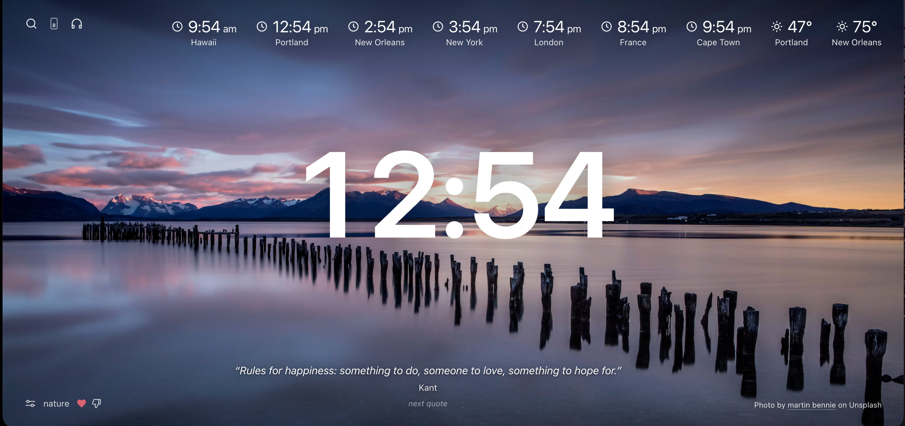
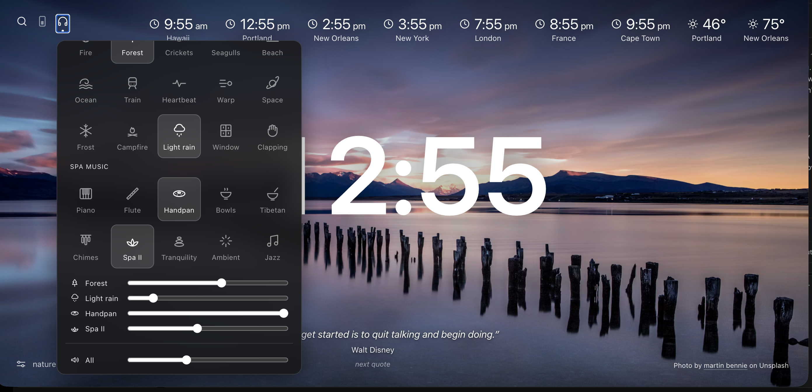

# Custom Starter Screen App

A new-tab page starter screen like momentum, but customized for me: a big clock over a fresh Unsplash photo, with world clocks, weather, a daily quote and nature sounds mixer.

## What's on it

- **Clock** in the middle, with world clocks and weather along the top
- **Background photos** from Unsplash, picked from the topics in `fetch-photos.js` (seasonal topics show up in their season)
- **Favorites and thumbs down**: heart a photo to keep it, thumbs-down one to never see it again
- **Quotes** at the bottom, with *next quote* to skip
- **Search** (press `/`) and an optional critter
- **Sounds** (headphones icon): nature sounds and spa music you can layer, each with its own volume slider plus one for everything

## Running it

No build and no server. Open `index.html` in a browser, or set it as your new-tab / home page.

## Files

| File | What it does |
| --- | --- |
| `index.html` | The page itself |
| `fetch-photos.js` | Unsplash key and the list of photo topics; edit it to change what you see |
| `prefs.json` | Favorites, blocked photos and settings (Chrome/Edge can write to it directly) |
| `prefs-to-js.js` | Copies `prefs.json` into `prefs.js` so every browser, Safari included, can read it: `node prefs-to-js.js` |
| `sounds/` | Nature sound loops; credits in `sounds/CREDITS.txt` |
